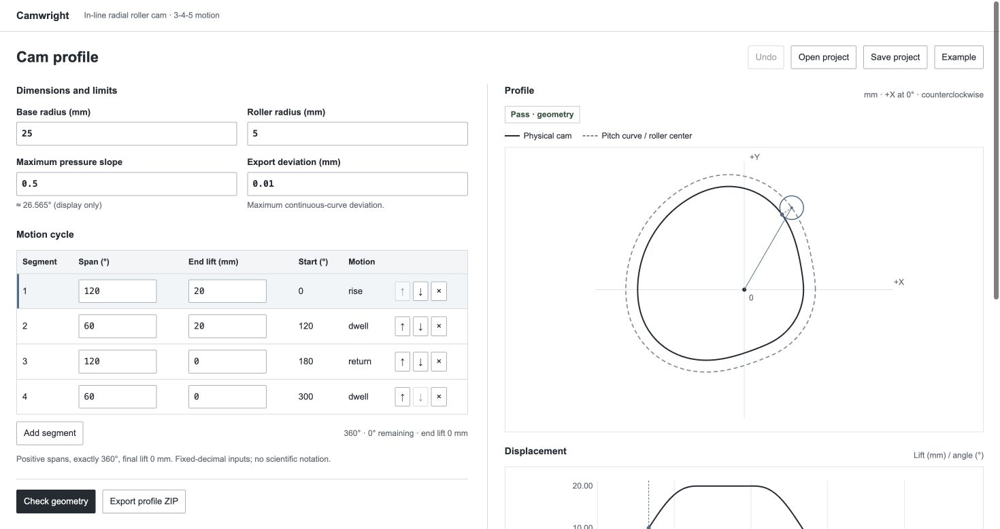
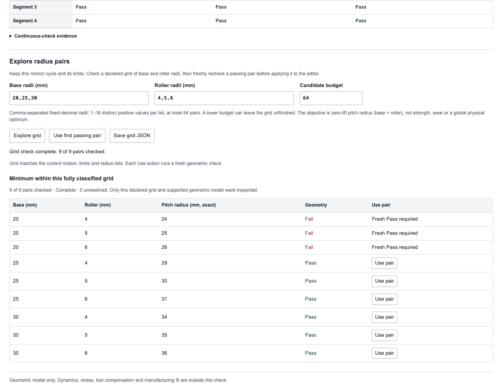

<p align="center"></p>

<h1 align="center">Camwright</h1>

<p align="center">Design an in-line roller cam, check its continuous geometry, and export the profile with bounded approximation error.</p>

<p align="center"><a href="#run-locally">Run locally</a> · <a href="#check-the-bundled-cam">Try the bundled cam</a> · <a href="#explore-in-the-workbench">Explore radius pairs</a> · <a href="https://github.com/nazeeh111/Camwright/releases/latest">Download latest release</a></p>



The recorded 20 mm example above fails the pressure check at a 60° witness. Its inspection can still be saved; profile export is disabled.

Current source is the unreleased **0.2.2.dev0** generation. Historical release assets and saved results retain their original implementation identities.

## Run locally

Runs locally with Python and its standard library. No account or network service is used.

From a source checkout, with Python 3.12 or newer:

```sh
python3 run.py
```

Open the printed `http://127.0.0.1:.../` URL if the browser does not open. Stop the local server with Ctrl+C. `python3 -m camwright --no-browser --port 8000` chooses an explicit port. The default chooses a free port.

To install locally:

```sh
python3 -m venv .venv
.venv/bin/python -m pip install .
.venv/bin/camwright
```

Installation builds a wheel using setuptools; running Camwright has no third-party Python dependencies. The source launcher needs no installation. Windows virtual environments use `Scripts` instead of `bin`.

## Check the bundled cam

Start with the bundled example and run its geometry check. Change the base radius from 25 mm to 20 mm and check again to see the pressure limit fail; save an inspection to keep that result. Edit spans and ending lifts in the motion table. Cumulative angles and remaining degrees help close the cycle. Add, reorder, remove and undo segments. The displacement plot and profile share an angle cursor. Save the exact project strings to JSON and reopen it through the file chooser. Edits immediately mark prior results stale and disable inspection saving and export.

### Motion and coordinates

All dimensions are millimetres and spans are degrees. The axis passes through the cam center. Zero angle is +X, positive angles are counterclockwise, and +Y is upward. The physical cam is drawn solid; the dashed pitch curve follows the roller center. Its zero-lift radius is base plus roller radius. The physical surface is the inward normal offset by one roller radius.

Each segment uses the 3-4-5 polynomial `s(u)=s0+h(10u³−15u⁴+6u⁵)`. Displacement, velocity and acceleration are continuous at joins. Programs have 1–12 positive spans, nonnegative lifts, exactly 360° total and final zero lift. Pressure uses an exact slope limit `(0,1]`, with its approximate angle displayed. An angle-to-slope conversion is not implemented.

The checker returns Pass, Fail with a witness angle, or Unresolved when its interval/depth limits cannot establish the result. It checks pressure, strictly convex pitch, and local roller curvature separately. Unresolved never means Pass. The displayed preview is sampled, visual-only geometry.

## Save an inspection

After a completed check, **Save inspection** downloads `camwright-inspection.zip` for any of the three statuses. Extract it and open `inspection.html` in a browser to read the observation offline. Its condition and motion tables preserve exact witness fractions, unresolved intervals/reasons, work counts and implementation limits. `inspection.json` preserves the exact entered project strings, identity, native result, model/units, implementation version and completion time. The inspection contains no CAD or profile geometry and establishes no export-tolerance Pass or hardware approval.

Saving uses the server's completed snapshot without recomputing it. One completed inspection is retained in bounded memory, shared by tabs on that server. Editing disables Save inspection; a new check, failed/cancelled check or server restart invalidates the old receipt. A failed save retains the draft; concurrent edits or a new check prevent a delayed response from downloading as current. To reuse a record's inputs, save its `project` object as a project JSON, open it normally and check again. Open project does not accept an inspection as a trusted result. Try `camwright/examples/rejected.json` and `camwright/examples/unresolved.json` for saved failure and numerical-boundary records.

## Export profile geometry

Export recomputes current geometric checks and builds a complete ZIP in memory. It contains `cam.csv`, `pitch.csv`, `cam.svg`, `pitch.svg`, `camwright-project.json`, `checks.json` and `export.json`, with `cam.dxf` and `pitch.dxf` when CAD delivery passes. The export status reports CAD availability separately from the continuous-curve bounds. CSV angles are exact rational degree strings under `angle_deg_exact`; coordinates are `x_mm,y_mm`. SVG negates Y for display and uses millimetres. The default tolerance is 0.01 mm; the application accepts 0.0001–1 mm. Whole-interval bounds cover both continuous curves, every motion join and closure, and the serialized coordinate rounding. Metadata records achieved bounds, orientation, units, project identity and implementation version. Failed or unresolved export produces no geometry download.

## Project input contract

Numbers are ASCII fixed-decimal strings, preserved exactly. Signs and forms such as `+.5` and `1.` are allowed. Strings have at most 32 characters, magnitude at most 100000 and at most 12 fractional places after trailing zeros are removed. Scientific notation, rational literals, whitespace, underscores, JSON floats and booleans are rejected. Projects are versioned, limited to 32 KiB, and reject duplicate or unknown keys. Invalid imports retain the draft.

## Local execution limits

Only one calculation runs at once in a separate process. Checks use 2,048 interval evaluations per condition/segment; export uses 8,192 shared interval evaluations and depth 24. A real 30-second deadline kills and reaps the worker. Busy requests return a retryable error; cancellation is restricted to the current project identity. Requests bind only to 127.0.0.1, enforce the printed Host and same-origin JSON POST, and accept no filesystem paths. Geometry ZIP downloads are limited to 8 MiB; inspection snapshot memory, combined uncompressed contents and download size are each limited to 512 KiB. This is a local workspace, not an internet server.

## Engineering limits

The bounds concern the stated geometric model and mathematical approximation. They do not establish dynamic loads, stress, spring contact, cutter compensation, dimensional accuracy after machining or fitness of hardware. Synthetic native DXF readback is covered by the backend handoff checks below; real machining has not been verified. The bundled `unresolved.json` is a deliberately tuned numerical-boundary example, not a recommended design.

[MIT license](LICENSE). See [geometry contract](docs/geometry.md) and [local API](docs/api.md).

## Development checks

Run checks with `python3 -m unittest discover -v`. The CI workflow runs the complete suite and an installed-wheel workflow on Python 3.12 and 3.14. The source archive includes the tests, installed smoke check, workflow and model/API docs.

When Node.js 18 or newer is available, the suite also checks frontend result announcements, segment focus, witness navigation and stale export gates. Run those cases directly with `node --test tests/frontend.test.cjs`. They exercise the real frontend with a small test-only DOM and HTTP substitute; browser layout and screen-reader speech need separate runtime checks.

## Finite design selection and CAD handoff

The installed CLI now supports a complete backend workflow, with no extra runtime
dependencies:

```sh
camwright example --out source.json
camwright explore source.json --base-radii 20,25,30 --roller-radii 4,5,6 --out grid.json
camwright select grid.json --out chosen.json
camwright check chosen.json
camwright export chosen.json --out profile.zip
camwright replay profile.zip
```

The declared nine-cell example rejects all20mm base candidates and selects
base25/roller4: zero-lift pitch radius29mm versus the original30mm. The objective
is this geometric pitch radius, not physical strength, wear or a universal
minimum. `--max-candidates` can stop exploration explicitly unfinished; unknown
checks never become Pass. Read `minimum_within_grid` separately from the presence
of a checked candidate. `select` always performs a fresh check. Optional
`--base-index` and `--roller-index` choose another cell; `--project current.json`
refuses a stale report against changed inputs.

Normal geometry ZIPs now contain closed millimetre DXF polylines as well as the
existing CSV/SVG. DXF uses exactly the certified emitted coordinates. Independent
ezdxf readback and task-owned CadQuery import were exercised on synthetic cams;
this does not establish machining, loading or manufacturing readiness. Very
small/coarsely approximated profiles can retain valid CSV/SVG while explicitly
marking CAD unavailable. See the [API and format contract](docs/api.md).

CLI `check` and a fully classified exploration exit0 even when their returned
geometric status is Fail/Unknown; inspect the result, not the process code, for
feasibility. Export/selection refusal or unfinished exploration exits3. Invalid
input, I/O/collision and replay mismatch exit2. No file is replaced. Export may
write a complete CSV/SVG-only archive and exit3 when CAD is unavailable. Replay
uses bounded in-memory ZIP admission, extracts no files, and freshly recomputes
all archived member contents under the current implementation. It is not a
signature or a physical verification. Interruption exits130; if interruption
occurs at publication, check whether the complete new file was already linked.

### Explore in the workbench



*Actual local nine-pair run: 3 Fail, 6 Pass; the 25/4 mm pair gives the 29 mm minimum zero-lift pitch radius within this grid. [Capture and source binding](docs/radius-grid-capture.md).*

The optional **Explore radius pairs** panel uses the same finite-grid checker.
Enter comma-separated fixed-decimal base and roller radii and a candidate budget.
It keeps the current motion cycle, pressure limit and export tolerance. Results
retain Pass, Fail and Unresolved for each checked pair, the checked/total count,
and an explicit unfinished state. A passing incumbent does not establish a
minimum when work remains or any checked pair is unresolved.

**Use first passing pair** or a row's **Use pair** performs a fresh geometric
check, applies only the returned exact project, and leaves the normal editor
ready for **Check geometry**, inspection and export. Editing inputs invalidates
selection from the prior grid. **Save grid JSON** preserves the declared source,
indices, outcomes and limits for the CLI workflow. It is not a trusted Pass
receipt; CLI selection also rechecks.

**Stop calculation** requests cancellation of the matching source's active
server calculation and waits for its response. A cancellation that cannot be
confirmed is not labeled as stopped work. Inputs stay editable while earlier
work finishes; late results and errors cannot replace the newer draft. A hard
deadline can return refusal rather than a partial grid. This is the existing
local worker boundary, not background execution or hardware control.

`camwright --version` and the read-only local `/api/health` identify this source
generation. The health response exposes no project, filesystem path or saved
result. Legacy launcher flags and JSON stdout/exit meanings are preserved.
Saved geometry replay compares every archive member, including implementation
identity, against a fresh current export. Use the matching retained release for
an old archive; version metadata differences are not silently certified as an
identical current result.

CLI inputs must be regular files and are captured once through a nonblocking, byte-bounded descriptor. FIFOs and devices are refused. Output publication never overwrites an existing path. If complete publication succeeds but removal of its owned staging file fails, the command succeeds and writes a structured cleanup warning to stderr identifying the leftover staging path. It does not retry a permission failure.
