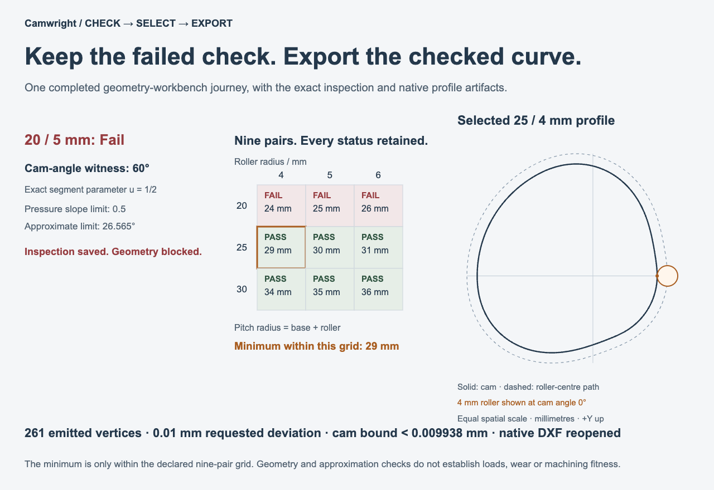

# Keep the failed check. Export the checked curve.

Camwright turns an exact motion cycle into continuous geometric checks and a bounded profile export. This actual current-main journey keeps a failed observation useful, then finds and freshly checks a passing pair in a declared finite grid. It produces a native geometry ZIP that replays exactly and reopens in CAD.



[Editable desktop vector](inspection-to-profile.svg) · [Phone vector](inspection-to-profile-mobile.svg) · [Failure workspace](failed-workspace.png) · [Selected workspace](selected-workspace.png) · [Phone workspace](workspace-mobile.png)

## Failure still produces an artifact

With base radius 20 mm and roller radius 5 mm, the motion fails the pressure condition. The first exact **cam-angle witness is 60°**, segment parameter `u=1/2`. This is a position in the cam cycle, not a 60° pressure angle. The input pressure-slope limit is exactly 0.5; the displayed approximate pressure-angle limit is 26.565°.

The actual workbench blocks profile export but allows **Save inspection**. [failure-inspection.zip](failure-inspection.zip) contains only `inspection.json` and self-contained `inspection.html`, preserving all four segments, every condition and exact certificates. The HTML was extracted and opened in a fresh phone viewport. A saved Fail is neither an export-tolerance Pass nor hardware approval. [Native failed result](failed-check.json).

## Choose from an explicit grid

The actual CLI and workbench classify base radii 20, 25, 30 mm crossed with roller radii 4, 5, 6 mm: **3 Fail, 6 Pass, 9/9 checked**. Within that complete grid, base 25 / roller 4 gives the minimum zero-lift pitch radius 29 mm, compared with the original 25/5 pair's30 mm. This is a geometric objective within nine declared candidates, not a global physical optimum or proof of lower wear/loads. Unfinished or unresolved grids cannot establish the same minimum.

The workbench's **Use first passing pair** performs a fresh backend check and applies the exact selected project. A normal **Check geometry** then updates its profile and enables export. The actual saved project reopens in a fresh context as unchecked and passes only after another check. Invalid import retains the valid draft/export state; a real edit disables stale inspection and export. Actual keyboard check/witness navigation,390px layout and captures are retained in [browser.json](browser.json). No application patch was needed for this bounded route.

From the complete current checkout with Python 3.12 or newer, choose new paths:

```sh
python3 -m camwright example --out source.json
python3 -m camwright explore source.json --base-radii 20,25,30 --roller-radii 4,5,6 --out grid.json
python3 -m camwright select grid.json --out chosen.json
python3 -m camwright check chosen.json
python3 -m camwright export chosen.json --out profile.zip
python3 -m camwright replay profile.zip
```

These are actual standard-library commands. Check/classified-grid exit 0 means a completed classification, including Fail; inspect the returned status. The failed export exits 3 without a geometry file. Existing outputs are refused. [Exact source project](source-project.json), [all nine native outcomes](radius-grid.json), [selected exact strings](selected-project.json), [native replay receipt](replay.json).

## Inspect the emitted geometry

The selected [profile.zip](profile.zip) contains all nine native files: physical cam and pitch CSV/SVG/DXF, exact project, geometric checks and approximation metadata. The actual CLI replays every member against a fresh export. The workbench's separate download contains exactly the same nine member bytes.

CSV has 261 vertices including the duplicate closing endpoint. Each DXF has 260 vertices and a closed flag, in millimetres. Native ezdxf readback confirms every coordinate equals the CSV; CadQuery independently reopens each as one valid closed planar face with matching bounds. This tests synthetic CAD delivery, not machining. [Native CAD check](cad-reopen.json), [UI/CLI artifact identity](artifact-check.json).

Requested maximum deviation is 0.01 mm. The native whole-interval upper bounds are `0.009937809102912628194507mm` for the physical cam and `0.008428774301465332171509mm` for the pitch curve. Bounds include joins, closure and serialized coordinate rounding under the implemented geometric model. [Full interval metadata](export.json), [native conditions](checks.json).

The figure uses every emitted CSV vertex, one equal physical x/y scale and the real 4 mm roller at cam angle 0°. Its center is the pitch point (29,0) mm and contact is the physical point (25,0) mm. Dashed pitch and solid physical curves are distinct; no smoothing or fabricated failed profile is shown. [Generator](figure.py), [mapping/data](figure-data.json), [bound inputs and exports](figure-manifest.json).

## Reopen the complete worked example

Extract [worked-example.zip](worked-example.zip) to a fresh directory. It includes the native profile/inspection ZIPs, projects, complete grid, exact checks, CSV/SVG/DXF and original MIT notice. Every manifest member is present. `python reopen.py` uses only the standard library to verify hashes, reopen the native bundles and summarize the stored outcomes. Fresh native rechecking uses the full current Camwright checkout, explicitly external to this data bundle.

Source parent `b34a6a84089a72beb999830862e5712d26070540`, tree `76f8b061e5936ccf3b94395f285bc7aba3e22711`, unreleased 0.2.2.dev0. The older inspection branch is six commits behind and is not overlaid. Existing expert workflows, runtime, tests and licenses remain unchanged. The original historical overview remains in the main README.

Lengths are mm, spans/cam angles are degrees, arithmetic inputs retain exact fixed-decimal strings, +X is zero angle and +Y is up. The model is an ideal in-line convex roller cam with 3-4-5 motion. No dynamic load, contact force, stress, cutter compensation, fabricated accuracy, global minimum or hardware fitness is established. [Complete geometry contract](../geometry.md) and [API/export limits](../api.md).
